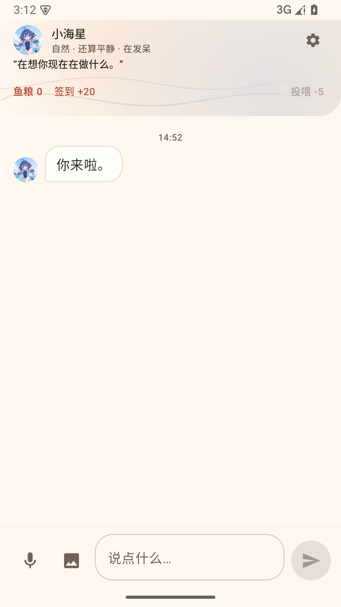
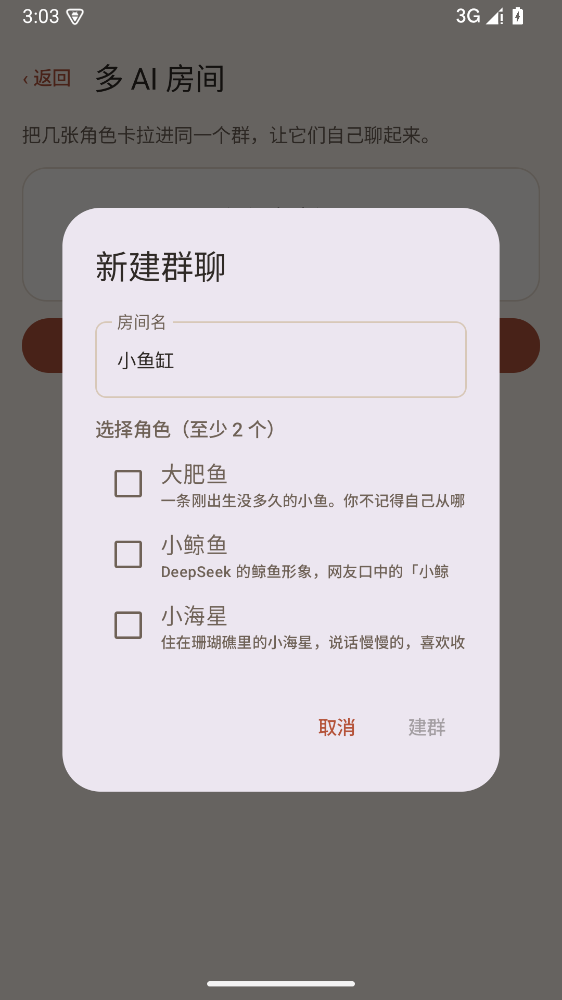
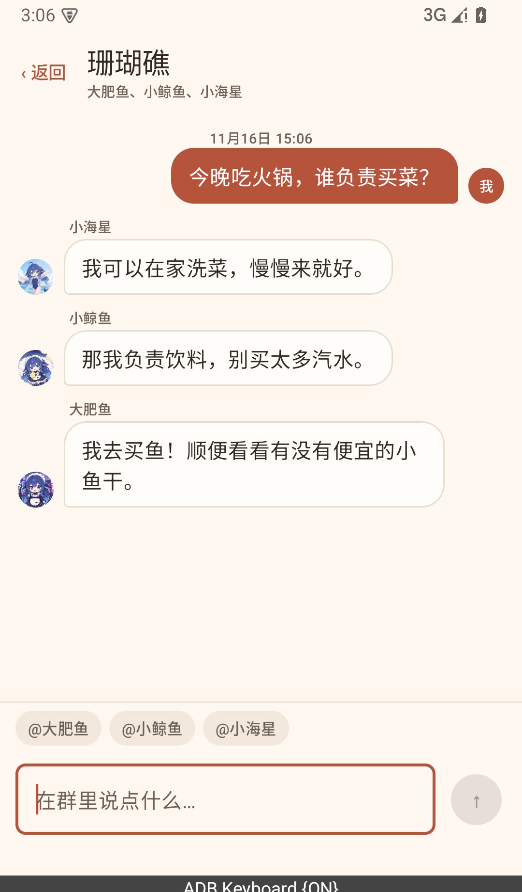
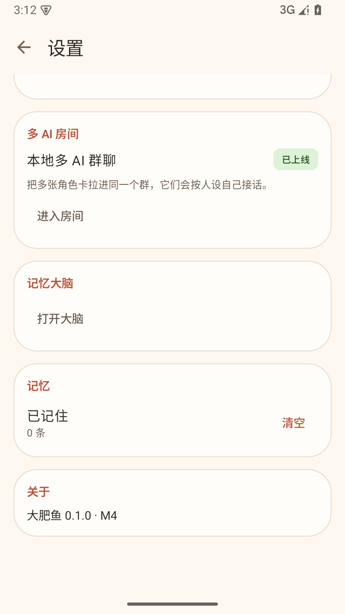
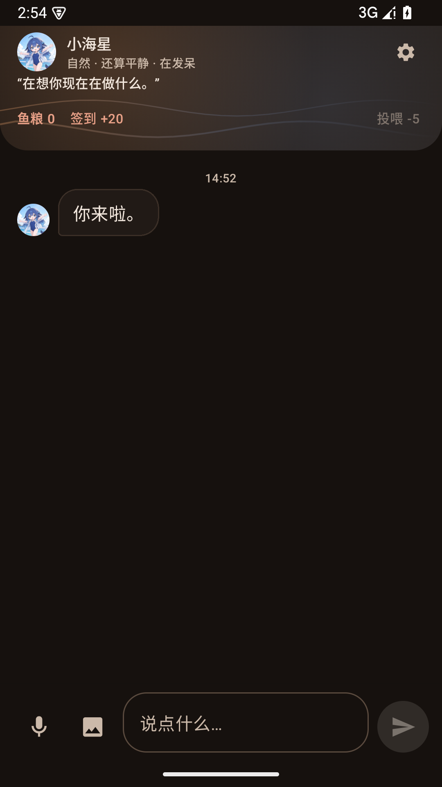

# 大肥鱼 Companion

一个本地优先的 AI 角色桌面宠物，也是一间可以住进多个 AI 角色的「群聊房间」。

你可以用文字创建多张角色卡，把至少两张卡拉进同一个房间。之后发一句话，角色们会按各自的人设、关系和话题相关度，自己决定谁先接话、谁补一句、谁保持沉默。

> 当前版本：`0.1.0 · M4`（开发预览版，Debug APK）
>
> 平台：Android 8.0+（minSdk 26），Jetpack Compose，Kotlin 2.0



## 多 AI 房间

| 房间列表 | 新建群聊 | 三个角色接话 |
|---|---|---|
|  |  |  |

一个房间里可以放多张角色卡。它们不是排队调用 API，而是由调度器决定发言顺序：

- **@ 优先**：消息里出现 `@名字`，对应角色优先接话。
- **话题相关度加权**：`talk * (0.35 + 0.65 * relatedness)`，和当前话题更相关的角色更容易开口。
- **冷却与连续发言限制**：同一角色不会无限刷屏，连续发言最多 2 条。
- **人类保底**：一轮没人接话时，`ensureHumanGetsReply` 会兜底选一个角色回应。
- **人设隔离**：每个角色带自己的 system prompt，历史记录以 `主人：...` 的 transcript 注入，避免串人设。
- **可见反馈**：`XX 正在输入…`、时间分隔、头像、错误提示条。

调度内核在 [`core/room`](core/room) 中，和 Android UI 解耦，可直接跑 JVM 单测：

```bash
./gradlew :core:room:test
```

## 其他能力

- **角色卡**：文字创建角色，支持头像、性格、说话风格、关系设定。
- **长期记忆**：本地 SQLite 保存对话与记忆，可在设置页查看、清空。
- **生活状态**：心情、饱腹度、鱼粮、签到与投喂。
- **主动消息与提醒**：WorkManager + AlarmManager，本地触发，不依赖服务端推送。
- **API Key 安全**：Key 使用 Android Keystore 中的 AES-GCM 密钥加密后保存，明文不落盘、不写日志。
- **本地优先**：除请求你配置的模型接口外，角色卡、房间、消息、记忆都留在设备上。

## 界面

| 主聊天 | 设置与多 AI 房间入口 | 深色模式 |
|---|---|---|
|  |  |  |

## 构建

环境要求：

- JDK 21
- Android SDK Platform 36、Build Tools 36.1.0
- Gradle 8.13（仓库提供 wrapper）

```bash
# Linux / macOS
export JAVA_HOME=/path/to/jdk-21
export ANDROID_HOME=/path/to/android-sdk
./gradlew :app:assembleDebug
```

```powershell
# Windows PowerShell
$env:JAVA_HOME="C:\path\to\jdk-21"
$env:ANDROID_HOME="C:\path\to\android-sdk"
.\gradlew.bat :app:assembleDebug
```

产物：`.build/app/outputs/apk/debug/app-debug.apk`

如果工作区文件索引会锁定 `build` 目录，可以把构建输出移到外部目录：

```bash
./gradlew :app:assembleDebug -Pcompanion.buildRoot=/tmp/companion-build
```

## 配置模型

首次启动后进入设置页，填写兼容 OpenAI Chat Completions 的接口地址与 API Key：

- Base URL，例如 `https://api.deepseek.com`
- API Key
- Model，例如 `deepseek-chat`

App 不内置任何厂商密钥。演示视频中的回复由本地脚本化 mock 服务生成，用于稳定录制，不代表真实模型输出。

## 测试

本轮在 Windows 电脑的 Android 模拟器（Android 15 / API 35，1080×1920）上完成，未使用真机 adb。

覆盖建群、三人群聊、`@` 提及、连续发言上限、沉默指令、双房间隔离、删除级联、进程重启持久化、深色模式等关键路径。详细用例、证据截图与未覆盖项见 [docs/TEST-REPORT.md](docs/TEST-REPORT.md)。

## 项目结构

```
app/                 Android UI、Room 数据库、运行时协调器
core/model           角色卡与消息模型
core/card            角色卡仓库
core/memory          记忆
core/room            群聊调度内核（纯 JVM，可单测）
core/llm             OpenAI 兼容客户端
core/proactive       主动消息
core/reminder        提醒
sim/                 桌面侧模拟与联调入口
```

## 已知限制

- 群聊 UI 目前没有暴露「回复指定角色」的入口；数据层已有 `reply_to` 字段。
- 5 分钟时间分隔、超长消息换行、接口不可用时的错误条尚未纳入本轮自动化回归。
- 当前为 Debug 签名，仅用于开发预览，不适合直接上架。
- 角色与对话内容由模型生成，请自行配置合规的模型服务并承担相应内容责任。

## License

[MIT](LICENSE)

角色头像与示例截图仅用于本项目演示。第三方模型、SDK 与字体遵循各自许可证。
